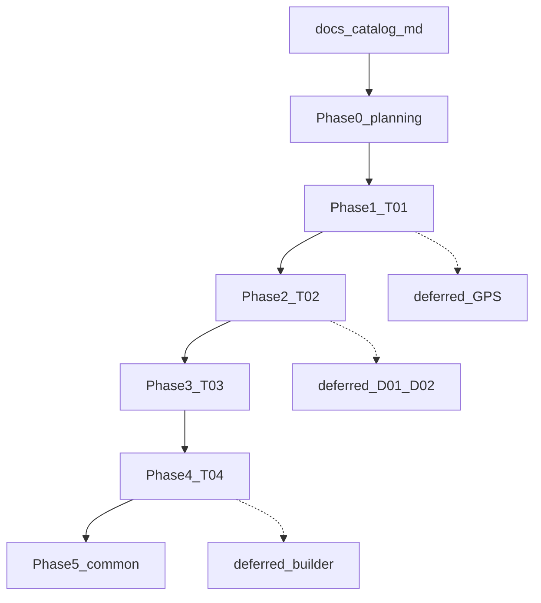

# 일정 DB화 v1 — 개발 가이드

전달본 v1.0(2026-09-18)을 기준으로, `/dataset` 격리 영역에서 장소 → 일정요소 → 블록 → 여정을 쌓는다. 기존 견적/확정 빌더와 `PlanStop`은 건드리지 않는다.

구현 PR은 해당 `phase-N-planning.md`를 링크한다. 기획 원본 HTML/ZIP은 레포 밖 참조이며, 레포에는 개발용 요약·결정만 둔다.

## 원본 기획

- 로컬 전달본: `/Users/luke/Documents/리더스/리더스투어_ERP_1차_개발전달_v1_0/`
- 열람: `전체보기.html` / `01_개발전달서.md` / `02_화면명세` / `05_개발검수표.md` / `06_개발협의사항.md`

## 마스터 원칙

1. 30화면 일괄 구현 금지. **모델 정합 → T01 → T02 → T03 → T04 → 공통축**.
2. 기존 견적/확정 빌더·PlanStop **미변경**. 신규 `/dataset` 영역만 확장.
3. Prisma **ADD-only**. 생산 테이블 ALTER 금지.
4. UI 상태 구분 필수: `미연동` / `자료 없음` / `미정` / `실제 0` / `연동 예정`.
5. D01~D10은 기능 제외가 아니라 **운영값·세부를 나중에 넣는 자리**. 숫자는 코드에 하드코딩하지 않음.
6. 각 Phase 종료 시 검수표 항목을 통과·보완·미구현으로 갱신.

## Phase 인덱스

| Phase | 문서 | 화면 | 상태 |
|-------|------|------|------|
| 0 | [phase-0-planning.md](./phase-0-planning.md) | 모델·갭·연결 인벤토리 | 완료 |
| 1 | [phase-1-planning.md](./phase-1-planning.md) | T01 장소·지역·경로 | 완료 |
| 2 | [phase-2-planning.md](./phase-2-planning.md) | T02 일정요소 | 완료 |
| 3 | [phase-3-planning.md](./phase-3-planning.md) | T03 일정 블록 1~n일 | 완료 |
| 4 | [phase-4-planning.md](./phase-4-planning.md) | T04 여정 템플릿 | 완료 |
| 5 | [phase-5-planning.md](./phase-5-planning.md) | T05~T08 공통축 | 골격 완료 |
| 후순위 | [deferred.md](./deferred.md) | GPS·수식·빌더 연동 | 보류 |

## 현재 코드 출발점

- UI: `apps/web/src/pages/dataset/`
- 훅/테마: `apps/web/src/features/dataset/`
- API: `apps/api/src/modules/catalog/`, `apps/api/src/schema/catalog.graphql`
- Zod: `packages/validation/src/catalog.schema.ts`
- Prisma: `infra/prisma/prisma/schema.prisma`의 `Catalog*` (기존 Location/Segment/Plan과 무관)

## Phase MD 공통 목차

1. 목표·범위·비범위
2. 화면/스토리
3. 데이터·API 변경
4. UI 구조
5. 검수표 매핑
6. 리스크·의존(D0x)
7. 작업 체크리스트
8. 완료 기록
